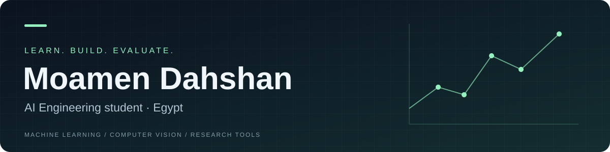

I am studying **Artificial Intelligence Engineering at Kafr El Sheikh University, Egypt**. My projects focus on machine learning, natural language processing, computer vision, and small research-oriented tools. This profile reflects the work currently visible in my repositories only, without adding any professional experience or unverified results.

[LinkedIn](https://www.linkedin.com/in/moamendahshan) · [Email](mailto:moamendahshann@gmail.com) · [Try NEON FIELD](https://neon-hand-moamen.daringtide16.chatgpt.site)

## Selected projects

| Project | What it explores | Technologies used |
| --- | --- | --- |
| [ResearchDesk AI](https://github.com/moamendahshann/researchdesk-ai) | A local PDF research workspace with page-level evidence, Arabic and English keyword search, and optional AI-assisted synthesis. | Python · FastAPI · SQLite · TF-IDF |
| [NEON FIELD](https://github.com/moamendahshann/neon-hand) | An interactive 3D neon particle experience controlled by hand tracking or mouse input, with an Arabic interface. | JavaScript · Three.js · WebGL · MediaPipe |
| [Sentiment Lens](https://github.com/moamendahshann/sentiment-lens) | An inspectable sentiment-analysis model for English reviews, with visible feature contributions. | JavaScript · TF-IDF · Logistic Regression |
| [Digit Classification](https://github.com/moamendahshann/digit-classification) | A handwritten digit classification experiment using an SVM pipeline and error analysis. | Python · scikit-learn · SVM |
| [Energy Forecasting](https://github.com/moamendahshann/energy-forecasting) | A reproducible time-series forecasting project comparing model performance with a simple seasonal baseline. | Python · scikit-learn · Time Series |
| [Wine Clustering](https://github.com/moamendahshann/wine-clustering) | An exploratory clustering project using KMeans, silhouette-based cluster selection, and PCA visualization. | Python · scikit-learn · KMeans · PCA |

## Skills and tools

- **Programming languages:** Python, JavaScript
- **Machine learning:** scikit-learn, classification, clustering, regression, time-series evaluation
- **NLP and AI:** TF-IDF, logistic regression, text processing, feature inspection
- **Computer vision:** hand tracking, image-based experiments, visual ML workflows
- **Applications and tooling:** FastAPI, SQLite, Three.js, WebGL, MediaPipe, Git, reproducible experiments, automated checks

These are student portfolio projects developed as part of my learning journey. They highlight the implemented work, reported evaluation methods, and project limitations rather than claiming professional experience or unrelated achievements.
